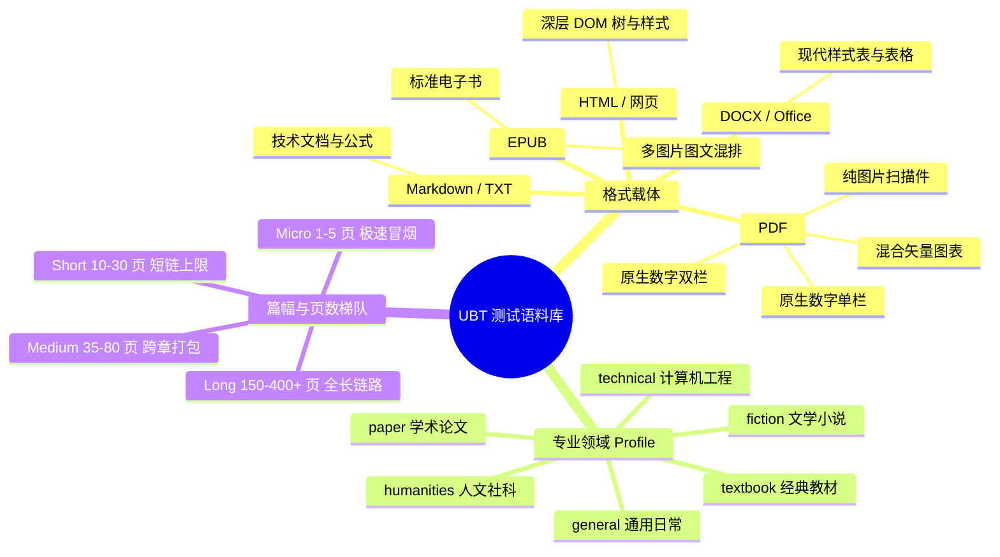
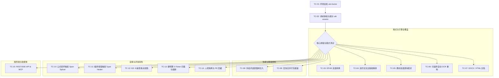

# UBT 全流程人工集成测试与端到端验收指南 (Manual E2E Integration Testing & Verification Spec)

> **文档状态**：🟢 活文档（随代码演进与质量门禁更新；代码符号与类型定义以 `ubt/` 源码为准）  
> **面向对象**：QA 工程师、交付工程师、算法评估员、高阶终端用户  
> **核心目标**：提供一套覆盖全载体格式、多专业领域、阶梯篇幅、Typst 重建渲染管线（文档由 IR 重建排版，不再对源页做图层合成）、渲染前预检与语法回退门禁、断点续跑及人机协作（HITL）的最后人工集成测试（Manual Integration Testing / UAT）端到端标准规程与执行用例集。

---

## 目录
- [一、 测试体系定位与前置环境准备](#一-测试体系定位与前置环境准备)
  - [1. 人工集成测试的定位与价值](#1-人工集成测试的定位与价值)
  - [2. 测试前置环境自检 (Pre-Test Environment Check)](#2-测试前置环境自检-pre-test-environment-check)
  - [3. 模型配置与凭据准备](#3-模型配置与凭据准备)
- [二、 测试文档准备详单 (Corpora Preparation Matrix)](#二-测试文档准备详单-corpora-preparation-matrix)
  - [1. 格式载体维度 (Format Types)](#1-格式载体维度-format-types)
  - [2. 专业领域画像维度 (Domain Profiles)](#2-专业领域画像维度-domain-profiles)
  - [3. 篇幅与页数梯队维度 (Scale & Page Tiers)](#3-篇幅与页数梯队维度-scale--page-tiers)
  - [4. 推荐基准测试语料库全景表](#4-推荐基准测试语料库全景表)
  - [5. 语料采集站点与获取路径](#5-语料采集站点与获取路径)
- [三、 翻译效果与交付质量核心关注维度](#三-翻译效果与交付质量核心关注维度)
  - [1. 文本与翻译语言质量 (Text & Linguistic Quality)](#1-文本与翻译语言质量-text--linguistic-quality)
  - [2. 版面几何与物理排版保真度 (Layout & Geometry Fidelity)](#2-版面几何与物理排版保真度-layout--geometry-fidelity)
  - [3. 复杂结构要素保真度 (Complex Structural Elements)](#3-复杂结构要素保真度-complex-structural-elements)
  - [4. 系统鲁棒性、自愈闭环与门禁合规 (System Health, Heals & Gates)](#4-系统鲁棒性自愈闭环与门禁合规-system-health-heals--gates)
- [四、 完整全流程集成测试用例集 (Test Cases TC-01 ~ TC-15)](#四-完整全流程集成测试用例集-test-cases-tc-01--tc-15)
  - [TC-01: 环境与渲染工具链自检 (ubt doctor)](#tc-01-环境与渲染工具链自检-ubt-doctor)
  - [TC-02: 译前体检、报价与智能路由决策 (ubt assess)](#tc-02-译前体检报价与智能路由决策-ubt-assess)
  - [TC-03: 单栏通俗读物 EPUB 双语转换 (EPUB / Dual)](#tc-03-单栏通俗读物-epub-双语转换-epub--dual)
  - [TC-04: 双栏密集公式学术论文出版级重排 (PDF / publication / Mono)](#tc-04-双栏密集公式学术论文出版级重排-pdf--publication--mono)
  - [TC-05: 学术教材出版级重排与双语逐块配对 (PDF / publication / Dual)](#tc-05-学术教材出版级重排与双语逐块配对-pdf--publication--dual)
  - [TC-06: 纯图片扫描版 PDF 自动 OCR 与版面重构 (Scanned PDF / Auto OCR)](#tc-06-纯图片扫描版-pdf-自动-ocr-与版面重构-scanned-pdf--auto-ocr)
  - [TC-07: 现代办公与网页文档双语转换 (DOCX / HTML)](#tc-07-现代办公与网页文档双语转换-docx--html)
  - [TC-08: 外挂术语表强制注入与全书术语一致性检验 (-g glossary)](#tc-08-外挂术语表强制注入与全书术语一致性检验--g-glossary)
  - [TC-09: 宏块合并打包提速与 Token 开销优化 (--macro-chunk-size)](#tc-09-宏块合并打包提速与-token-开销优化---macro-chunk-size)
  - [TC-10: 异常注入：公式占位符篡改触发 Span Splicer 微创自愈](#tc-10-异常注入公式占位符篡改触发-span-splicer-微创自愈)
  - [TC-11: 异常注入：渲染前预检与语法回退门禁](#tc-11-异常注入渲染前预检与语法回退门禁)
  - [TC-12: 进程非正常终止与 SQLite WAL 账本断点续跑零开销恢复](#tc-12-进程非正常终止与-sqlite-wal-账本断点续跑零开销恢复)
  - [TC-13: 硬预算限制开跑前拦截与运行时熔断 (--budget-usd)](#tc-13-硬预算限制开跑前拦截与运行时熔断---budget-usd)
  - [TC-14: 人机协作隔离队列导出与审校数据回灌 (ubt pe-import)](#tc-14-人机协作隔离队列导出与审校数据回灌-ubt-pe-import)
  - [TC-15: 服务端 REST/SSE 与 MCP 智能体协议端到端集成 (ubt-api & ubt-mcp)](#tc-15-服务端-restsse-与-mcp-智能体协议端到端集成-ubt-api--ubt-mcp)
- [五、 人工验收核对表与缺陷裁定准则](#五-人工验收核对表与缺陷裁定准则)
  - [1. 缺陷严重度分级定义 (Severity Rubric)](#1-缺陷严重度分级定义-severity-rubric)
  - [2. 一票否决硬指标 (Veto Criteria)](#2-一票否决硬指标-veto-criteria)
  - [3. 交付验收合格声明标准 (Release Sign-off Criteria)](#3-交付验收合格声明标准-release-sign-off-criteria)
- [六、 典型测试异常排查与救援指南 (Troubleshooting)](#六-典型测试异常排查与救援指南-troubleshooting)

---

## 一、 测试体系定位与前置环境准备

### 1. 人工集成测试的定位与价值
自动化测试（单元测试、基线回归测试 `tests/baselines`、CI 静态检查）能够保证代码逻辑的确定性、状态机流转的严格性以及 0-Token 不变量的绝对守恒。然而，自动化测试具有天然局限性：
- Mock 模型无法模拟真实 LLM 在长上下文中偶发的发散、幻觉与语域偏移；
- 像素忠实度与 BIoU 自动化打分只能量化几何残差，无法替读者评估中文字偶排版的呼吸感、可读性与阅读疲劳度；
- 真实世界文档（尤其是扫描件、畸形排版 PDF）充满不可预测的排版杂质与字体残留。

**人工集成测试（Manual Integration Testing）是交付正式生产版本前的终极把关**，其使命是：通过真实大模型推理与真机物理渲染，全面穿透“解析 $\to$ 术语提炼 $\to$ 初译 $\to$ 门禁质检 $\to$ 自愈修复 $\to$ 排版编译”六阶段全链路，验证系统在各种极限压力与异常扰动下的鲁棒性、保真度与阅读体验。

### 2. 测试前置环境自检 (Pre-Test Environment Check)
在展开任何测试前，必须确保宿主机测试环境完整可用。

执行命令：
```bash
uv run ubt doctor
```

**必须通过的自检清单**：
- [x] **凭据配置**：`UBT_LLM_API_KEY`（或 Profile 配置）有效识别，且具备模型推理额度。
- [x] **账本目录**：`.ubt/ledgers/` 具备正常的 SQLite WAL 读写权限。
- [x] **记忆库**：`tm.sqlite` 可正常连接并创建/读取索引。
- [x] **排版编译器**：`typst` 已安装在 PATH 中（版本建议 $\ge 0.11.0$）。
- [x] **矢量/栅格工具**：Poppler 的 `pdftotext` 可用（artifact parity 依赖它）；Python `pdf-oxide`、`pypdfium2`、`Pillow` 正确加载。
- [x] **中文字体安装**：系统必须装有学术规范字体：`Noto Serif CJK SC`（思源宋体，Reflow 核心中文字体）与 `Noto Sans CJK SC`（思源黑体，标题/无衬线备用字体）。如缺失会导致 Typst 无法渲染中文或产生方块乱码。
- [x] **重型解析器（可选）**：若需测试 Docling 复杂多栏解析，确认 `uv sync --extra docling` 完成，模型权重已缓存。

### 3. 模型配置与凭据准备

内置的只有**四个线路协议**及其简称，没有任何厂商预设：

| 协议（写在 `[providers.*]` 里的名字） | 简称 | 默认端点 |
|---|---|---|
| `openai-chat` | `openai`、`chat` | `https://api.openai.com/v1` |
| `openai-responses` | `responses` | `https://api.openai.com/v1` |
| `anthropic-messages` | `anthropic`、`claude`、`messages` | `https://api.anthropic.com` |
| `gemini-native` | `gemini` | `https://generativelanguage.googleapis.com/v1beta` |

**`deepseek`、`opencode` 之类的厂商名不是内置的** —— 它们必须自己在 `ubt.toml` 里声明成 `[providers.<name>]` 块，否则会报 `ProviderNotFoundError`。

用内置协议不需要配置文件，但**还必须给出模型名**，否则无法运行：

```bash
export UBT_PROVIDER=gemini              # 内置简称，解析到 gemini-native
export UBT_LLM_API_KEY="AIzaSy..."      # 唯一被识别的通用密钥变量名
export UBT_DRAFT_MODEL="gemini-3.8-flash"   # 必须；内置协议只提供端点与协议
```

注意凭据只用 `UBT_LLM_API_KEY`。引擎**故意不嗅探** `GEMINI_API_KEY`、`OPENAI_API_KEY` 这类第三方变量名：误读别人账号的密钥会把整本书译到用户没选过的账户上。

凭据可直接在 `ubt.toml` 中配置（`api_key = "..."`，已被 `.gitignore` 忽略保护），或通过 `${VAR}` 展开引用环境变量：

```toml
# Vendor blocks state their own base_url and protocol. Without them the run
# inherits the built-in default, which is api.openai.com — a Gemini model id
# would be sent there and fail with a 404 naming a model the endpoint never had.
[providers.test-gemini]
base_url = "https://generativelanguage.googleapis.com/v1beta"
api_mode = "gemini-native"
api_key = "${UBT_LLM_API_KEY}"
draft_model = "gemini-3.8-flash"
repair_model = "gemini-3.1-pro"

[providers.test-deepseek]
base_url = "https://api.deepseek.com/v1"
api_mode = "openai-chat"
api_key = "${UBT_LLM_API_KEY}"
draft_model = "deepseek-chat"
repair_model = "deepseek-reasoner"
```

声明了多个块时，还要选出默认用哪个——否则 `UBT_PROVIDER` 缺失时 `provider` 为空，提交会退化成演练：

```toml
[defaults]
provider = "test-gemini"
```

---

## 二、 测试文档准备详单 (Corpora Preparation Matrix)

为彻底消灭盲区，测试人员必须按照**“格式载体 $\times$ 专业领域 $\times$ 篇幅梯队 $\times$ 特殊排版特征”**四维矩阵准备测试语料。



### 1. 格式载体维度 (Format Types)
UBT 官方支持输入格式权威清单见 `ubt.adapters.factory.supported_suffixes()`，测试集必须全部覆盖：

1. **PDF 格式（核心压力载体）**：
   - **Form-1：数字原生单栏 PDF (Born-digital Single-column)**：纯净单栏文本流，含标准页眉页脚、目录大纲、标准衬线字体。
   - **Form-2：数字原生双栏/多栏学术论文 (Multi-column Paper)**：IEEE / ACM / arXiv 样式，双栏正文并排，穿插跨栏单栏表格与全宽公式。
   - **Form-3：纯图片扫描版 PDF (Scanned Image-only)**：无文字层（`has_text_layer=False`），包含倾斜、手写标记、泛黄底噪、双面透字（用于压测 OCR 路由与容错）。
   - **Form-4：公式与图表密集型专著 PDF (Formula & Diagram Heavy)**：包含大量行内公式、行间多行对齐方程组（align/gather）、矩阵、TikZ/矢量插图、多级复杂表头表格。
2. **EPUB 电子书**：
   - 包含多级 TOC 目录、标准 CSS 样式、多章回结构、正文嵌入插图（用于测试原样重打包、OPF 元数据与图片资产保全）。
3. **DOCX 文档**：
   - 包含 Word 标准样式（Heading 1~4、正文缩进、项目符号列表、复杂嵌套表格、内嵌图片）。
4. **Markdown (`.md` / `.markdown`) 与纯文本 (`.txt`)**：
   - Markdown 包含 ATX 标题、YAML Frontmatter、LaTeX 数学公式语法（`$...$`, `$$...$$`）、代码块（含 Python/C++ 语法高亮标识）、Markdown 语法表格。
   - TXT 纯文本用于测试无标记空行段落分块（Plain text fallback）。
5. **HTML / 网页 (`.html` / `.htm`)**：
   - 包含标准 HTML5 结构标签（`<article>`, `<section>`, `<h1>`, `<p>`, `<table>`, `<figure>`, `<blockquote>`），测试标签级文本提取与双语注入。

### 2. 专业领域画像维度 (Domain Profiles)
系统内置六大领域画像参数（`--profile`，别名 `--domain`），测试语料必须涵盖各领域的专业行文范式：

| 领域画像 (`--profile`) | 核心行文特征 | 典型语料场景 | 测试重点 |
| :--- | :--- | :--- | :--- |
| **`general`** | 日常生活、新闻通识、轻度非虚构 | 传记、生活科普、通俗读物 | 语言流畅通顺，无生硬翻译腔，无上下文倒错。 |
| **`textbook`** | 教材体系、知识要点、边栏（Sidebars）、习题 | 大学教材（物理、心理学、经济学） | 4 层流隔离防污染（正文与边栏互不污染），概念阐释清晰。 |
| **`paper`** | 严谨学术、被动语态、浓缩摘要、数学符号 | arXiv 计算机、量子物理、生物医学论文 | 严守中国学术规范，公式占位符绝对不丢，图表标号与引用严格对齐。 |
| **`fiction`** | 文学叙事、人物对白、环境描写、隐喻抒情 | 世界名著短篇/长篇小说 | 人物称谓前后统一，对白自然有代入感，标点符合中文文学出版规范。 |
| **`humanities`** | 复杂长难句、哲学思辨、学术流派术语、拉丁短语 | 哲学专著、世界史论、法学评述 | 严防长句断句错位，精准识别并对齐先贤人名与历史专有名词。 |
| **`technical`** | 操作指示明确、API 签名、代码块、CLI 参数 | 编程语言实战、云原生架构手册 | 代码块字节级完全保留（`skip_translate=1`），技术参数与术语零篡改。 |

### 3. 篇幅与页数梯队维度 (Scale & Page Tiers)
篇幅直接决定了 UBT 路由决策树的执行模式（短链 vs 长链）与系统资源的驻留压力：

| 篇幅档位 | 页数/字数范围 | 触发系统行为 | 测试目标 |
| :--- | :--- | :--- | :--- |
| **Tier-1: Micro (极速冒烟档)** | 1 ~ 5 页<br>(< 2,500 词) | 触发切片处理（`--pages 1-5`）或短链执行 | 快速检验 CLI 连通性、Pre-flight 渲染、基本解析与语法编译。 |
| **Tier-2: Short (单兵极速链路档)** | 10 ~ 30 页<br>(5,000 ~ 15,000 词) | 命中短文档上限阈值（`short_max_pages=30`），走 `exec_mode="short"` 单兵整章快速改写 | 验证快速短链下的视觉门禁强阻断、短链提示词装配与局部微创修补。 |
| **Tier-3: Medium (中篇长链档)** | 35 ~ 80 页<br>(20,000 ~ 50,000 词) | 跨越短链阈值，自动进入 6 阶段长链流水线，生成全书“术语圣经” | 验证宏块合并打包（`--macro-chunk-size 5`）、L1/L2 记忆快照、术语圣经提取。 |
| **Tier-4: Long (长篇大部头全链档)** | 150 ~ 400+ 页<br>(100,000 ~ 300,000+ 词) | 完整长链流水线，触发多章节流式解耦与剧情/学术滚动摘要 | 验证跨章滚动摘要（`--rolling-summary`）、SQLite WAL 账本高并发事务、长时间内存泄漏控制与断点续跑。 |

### 4. 推荐基准测试语料库全景表
为便于测试人员直接采集，以下给出真实公开（公有领域或开源许可）的标准测试文档样本推荐：

| 编号 | 语料名称 | 格式 | 推荐页数/篇幅 | 对应领域 | 版面特征 | 建议测试重点 | 公开获取来源 |
| :--- | :--- | :--- | :--- | :--- | :--- | :--- | :--- |
| **DOC-01** | *Attention Is All You Need* | PDF | 15 页 | `paper` | 双栏、跨栏表格、数学公式、模型架构图 | 表格重建保真度、公式转换、图资产完整 | arXiv: 1706.03762 |
| **DOC-02** | *DeepSeek-V3 Technical Report* | PDF | 54 页 | `paper` | 密集复杂长公式、大规模基准测试表格 | Auto 路由决策、大文档吞吐、公式见证 | arXiv: 2412.19437 |
| **DOC-03** | *Cognitive Psychology (Ch.03)* | PDF / MD | 28 页 | `textbook` | 多栏混排、知识卡片边栏、代码示例 | 边栏独立流（`sidebar_aside`）防正文污染 | 教材开源公开样章 / 项目内基准 |
| **DOC-04** | *Alice's Adventures in Wonderland* | EPUB | 12 章 / 45 图 | `fiction` | 标准多章节、插画环绕、诗歌排版 | EPUB 重打包、图片资产、人物称谓一致性 | Standard Ebooks 版 |
| **DOC-05** | *The Call of the Wild* | EPUB / TXT | 7 章 / 全长 | `fiction` | 长篇连续叙事、动植物专有名词 | 跨章滚动摘要、断点续跑与内存驻留 | Project Gutenberg #215 |
| **DOC-06** | 历史文献/古籍扫描件样本 | PDF (扫描) | 10 页 | `humanities` | 纯图像、泛黄底噪、无矢量文本层 | OCR 自动路由探测、去噪提取、虚假报价防御 | 互联网档案馆 (Internet Archive) 公开文献 |
| **DOC-07** | *Kubernetes Operator Whitepaper* | DOCX | 25 页 | `technical` | 嵌套标题、架构流程图、配置清单表格 | DOCX 样式保持、标题层级树、表格单元格 | CNCF 公开白皮书 Word 版 |
| **DOC-08** | *Python PEP 8 / Rust Guide* | Markdown | 12,000 词 | `technical` | 连续代码块、行内反引号、提示块 | 代码块 `skip_translate=1` 字节级保护 | Python 官方 PEP 8 源码 |
| **DOC-09** | W3C 规范标准网页文档 | HTML | 单页长文 | `technical` | 复杂 DOM 树、规范定义列表、内联超链接 | HTML 标签级文本提取、双语段落注入 | W3C 规范静态归档 |
| **DOC-10** | 极简 2 页宣传折页/合同公文 | PDF | 2 页 | `general` | 扁平单页、背景表格、公章位置固定 | 表格重建、短文档快链路防截断 | 合同/发票公文模版 |

### 5. 语料采集站点与获取路径
§4 的「公开获取来源」列在此展开为可直接访问的站点，供测试人员按领域与格式采集。**优先公有领域或开放许可（CC / 开源）**语料；商用交付测试避开版权在保作品。

**A. 按专业领域画像（`--profile`）**

| 领域画像 | 推荐站点 | 适配理由 / 对应样本 |
| :--- | :--- | :--- |
| `paper` | arXiv (`arxiv.org`，重点 `cs.CL/cs.LG/quant-ph`)、ACL Anthology (`aclanthology.org`)、OpenReview (`openreview.net`)、bioRxiv/medRxiv、PubMed Central (`ncbi.nlm.nih.gov/pmc`) | 原生 LaTeX 双栏、密集公式、跨栏表格；对应 DOC-01/02 |
| `textbook` | OpenStax (`openstax.org`)、Open Textbook Library (`open.umn.edu/opentextbooks`)、LibreTexts (`libretexts.org`)、MIT OCW (`ocw.mit.edu`) | 多栏混排 + 知识卡片边栏（`sidebar_aside` 防污染）；对应 DOC-03 |
| `fiction` | Project Gutenberg (`gutenberg.org`)、Standard Ebooks (`standardebooks.org`) | 长篇叙事、人物称谓一致性、断点续跑；对应 DOC-04/05 |
| `humanities` | Internet Archive (`archive.org`)、HathiTrust (`hathitrust.org`)、Library of Congress (`loc.gov`)、Stanford Encyclopedia of Philosophy (`plato.stanford.edu`) | 长难句、扫描件/泛黄底噪（OCR 路由压测）；对应 DOC-06 |
| `technical` | Python PEP (`peps.python.org`)、Rust Book (`doc.rust-lang.org/book`)、CNCF/Kubernetes (`kubernetes.io`、`cncf.io`)、W3C 规范 (`w3.org/TR`)、GitHub raw Markdown (`raw.githubusercontent.com`) | 代码块字节级保护、标题层级树、复杂 DOM；对应 DOC-07/08/09 |
| `general` | SEC EDGAR (`sec.gov/edgar`，10-K 年报)、govinfo (`govinfo.gov`)、World Bank / UN 报告 | 扁平单页、背景表格、公章位固定；对应 DOC-10 |

**B. 按格式载体**

| 格式 | 推荐来源 |
| :--- | :--- |
| PDF 原生双栏 / 公式 | arXiv、ACL Anthology、OpenReview、IEEE/ACM 会议论文 |
| PDF 扫描件（无文字层） | Internet Archive、HathiTrust、Library of Congress、Google Books；古籍 / 民国文献 |
| EPUB | Project Gutenberg、Standard Ebooks |
| DOCX | CNCF / 厂商白皮书 Word 版；或由 LibreOffice 将 ODT/PDF 转换生成 |
| Markdown / TXT | PEP（reST/MD）、Rust/Go 官方文档源码、GitHub `raw.githubusercontent.com` |
| HTML | W3C `w3.org/TR`、MDN、Stanford Encyclopedia of Philosophy |

**C. 采集注意事项**
1. **许可**：优先公有领域（Gutenberg / Standard Ebooks / Internet Archive）或 CC（OpenStax / LibreTexts / arXiv 多为开放许可）。
2. **文字层验证**：扫描件先用 `pdffonts`/`pdftotext` 确认无文字层，才能命中 TC-06 的 OCR 路由分支。
3. **篇幅梯队**：按 §3 的 Tier-1~4 各备至少一份。
4. **双栏 / 公式密度**：用 `ubt assess --deep --json` 预检 `PROBE_FORMULA_SHARE`，确认公式密度被正确识别并选择 high_fidelity preset。
5. **多语言对**：如需非 en→zh，可补充 OPUS (`opus.nlpl.eu`)、FLORES-200、WMT 测试集；注意 UBT 的 en→zh 是一等公民，同语系互译是能力降级（源与目标同属拉丁字母时 `min_target_ratio` 自动归零，字符类别比无法区分源残留与译文）。

---

## 三、 翻译效果与交付质量核心关注维度

测试人员在最后验收产物时，必须依据以下四大维度及详尽判据逐一打分核对：

### 1. 文本与翻译语言质量 (Text & Linguistic Quality)

```text
┌─────────────────────────────────────────────────────────────┐
│                 文本质量五重红线审查                        │
├─────────────────────────────────────────────────────────────┤
│ 1. 严禁无意漏译与跳句 (Zero Unintended Omits)               │
│ 2. 严禁模型自言自语与脚手架残留 (Zero Scaffolding Leakage) │
│ 3. 严禁专有名称全书打架 (Consistent Translation Bible)      │
│ 4. 严守中国学术科技与文学表达规范 (Register Compliance)    │
│ 5. 绝对守恒阿拉伯数字与物理度量衡 (Numeric Invariants)      │
└─────────────────────────────────────────────────────────────┘
```

- **① 完整性与无漏译（Completeness）**：
  - 核对正文每一段落是否均有对应译文，严禁整段或末句静默丢失；
  - 检查括号内补充说明、括号内年份是否被遗漏。
- **② 提示词脚手架与幻觉零泄漏（No Scaffolding Leakage）**：
  - 严禁出现大模型自我对话（如：“以下是我的翻译：”、“好的，我将扮演翻译家…”）；
  - 严禁出现保护性占位符残留（如 `⟦MATH_MASK_0001-a3f⟧`、`⟦CODE_REF_...⟧`）。
- **③ 术语与实体一致性（Glossary & Entity Consistency）**：
  - **人物/地名全书统一**：小说中的主角译名（如 Buck、John Thornton）不得在后续章节出现别字或音译漂移；
  - **专业概念全书统一**：如“Self-Attention”全书统一为“自注意力机制”，“Epoch”统一为“轮次”或“迭代周期”；
  - **外挂术语表硬性命中**：传参 `-g glossary.csv` 时，检查译文中目标术语的命中率必须为 100%。
- **④ 语域风格规范（Register & Tone）**：
  - **学术论文**：行文精炼、使用符合规范的中国科技学术汉语，避免第一人称口语化表达；
  - **教材**：概念定义明晰，例题叙述通俗，符合教学法语言习惯；
  - **小说**：描写富有中文美感，对白符合角色身份，标点符合中文排版习惯（如英文直引号 `"` 规范转换为中文双引号 `“”`）。
- **⑤ 数字、日期与符号绝对守恒（Invariants）**：
  - 原文出现的年份、实验数据指标（如 `Accuracy 98.45%`、`p < 0.05`）、编号，译文中阿拉伯数字集合必须严格一致，禁止擅自取整或单位篡改。

### 2. 版面几何与物理排版保真度 (Layout & Geometry Fidelity)

只有一条 PDF 渲染路径：文档由 IR 重建、Typst 从零排版（文本重排、页数变化，交付物是新文档而非源版式的复制）。几何保真不靠"贴回源页画布"，而是靠排版质量与双语配对；`dual_mode`（`mono`/`dual`/`auto`）决定逐块配对还是纯译文，是唯一的模式旋钮。

#### A. Typst 重排验证重点
- **字体与美感**：中文字体必须为平滑正宗的学术宋体（`Noto Serif CJK SC`），西文与数字自然混排回退，无豆腐块（方框乱码）；正文字号统一（10.5pt），字号种类从源文档的数十种收敛到个位数；
- **双语对齐表现**：
  - `dual`（逐块配对）：每个块的源文行显示在其译文上方，中英文段间距均匀，绝无文字重叠（Overlap）；`auto` 由顾问按文档结构选择；
  - `mono`（纯译文单语）：版面整洁舒展，符合标准印刷品规范；
- **版心溢出防线**：检查有无长文本脱离页边距（Margin Overflow）被打印机裁切线切断。

#### B. 交付契约验证重点（所有 PDF 用例通用）
- **契约零违规**：`*_contract.json` 报 0 error——文本全部 delivered（除刻意保留项计入 source-kept），资产零 missing；
- **页码守恒**：OCR/提取丢失的块不会静默消失——质量报告的块计数与源文档估块一致；
- **防截断**：重点检查段落末尾是否被页边裁切（Clip）导致半行字丢失，或与下方图表发生碰撞。

#### C. EPUB / DOCX / HTML 原生重排验证重点
- **EPUB**：使用 Calibre / Apple Books 打开，检查封面是否完整展示，目录是否可正常点击跳转，章节翻页流畅，图片位置未错乱；
- **DOCX**：使用 Microsoft Word / WPS 打开，检查文档导航窗格（大纲视图）层级完整，表格未被长译文撑出右边界；
- **HTML**：在 Chrome / Firefox 中查看，CSS 响应式布局完好，双语对照段落结构清晰，无破坏未闭合的 `</div>` 标签。

### 3. 复杂结构要素保真度 (Complex Structural Elements)

| 结构要素 | 错误致命形态 | 人工验证标准与及格线 |
| :--- | :--- | :--- |
| **数学公式 (Formulas)** | 公式变量名被汉化（如 $x_{train}$ 被译为 $x_{训练}$）；LaTeX 语法破坏报错；编号错位 | 1. 变量名、函数名（$\sin, \log$）、上标、下标、希腊字母 **100% 字节级不变**；<br>2. 矩阵括号对齐无截断；<br>3. 行间公式独立居中且公式编号（如 `(1.2)`）完美对齐；<br>4. MathJax 矢量高清呈现，无锯齿模糊。 |
| **复杂表格 (Tables)** | 表格被拍平成普通纯文本段落；单元格内容串列错位；跨行跨列表头丢失 | 1. 严格保持原始表格网格拓扑结构（Rows $\times$ Cols）；<br>2. 表头文字正确翻译，但表内纯数字指标和单位严格对齐；<br>3. 复杂合并单元格（Merged Cells）无崩解。 |
| **代码与命令行 (Code)** | 代码关键字被翻译（如 `for i in range` 变成 `对于 i 在 范围`）；缩进空格破坏 | 1. 代码块文本 **100% 字节级零翻译（`skip_translate=1`）**；<br>2. 语法高亮标签与行号保持原样；<br>3. 仅当配置允许翻译注释时，注释翻译后其注释符号（`#`, `//`）必须完好。 |
| **插图与图题 (Images & Captions)** | 图片丢失全白；图题与正文混杂；交叉引用失效（如正文引用“见图3”，译文变“见图5”） | 1. 图片资产 **零丢失、零降质**；<br>2. 图题（Figure Caption）精准挂靠在图像下方；<br>3. 正文中的交叉引用标号严格一致。 |
| **独立语义流 (Sidebars & Callouts)** | 教材边栏小贴士内容插入正文叙事中间，导致前后段落意思截断 | 1. **4 层流隔离防线**生效：`sidebar_aside` 独立排版，绝不插在句子中间；<br>2. 背景卡片框完整包裹边栏译文。 |
| **版式元信息 (Chrome: Headers / Footers)** | 页眉把书名翻得千奇百怪；页码被翻译成中文大写（如“第 3 页”变成“第三页”引发溢出） | 1. 默认不翻译页眉页脚（`translate_chrome=False`，即 `--no-translate-chrome` 的默认态）：页眉页脚页码维持原样；<br>2. 目录 TOC 页码与实际目标排版页码相互吻合。 |

### 4. 系统鲁棒性、自愈闭环与门禁合规 (System Health, Heals & Gates)
- **账本生命周期完整性**：查看 `.ubt/ledgers/<job_id>.sqlite`，所有块必须流转至终端状态（`TERMINAL_STATUSES`：`MTQE_PASSED`, `REPAIRED`, `BLOCKED_HUMAN`, `NEEDS_HUMAN`，或非致命 `FAILED`），不得长期悬挂在中间状态；
- **自愈审计（以质量报告 / 账本为权威证据，日志仅辅助）**：
  - **译文微创修补**：`SpanRepairSplicer`（`ubt/core/validators/span_repair.py`，由 `RepairLoop` 调用）只修瑕疵局部、不重译整段。权威证据是质量报告的 `repair_breakdown`（`round_1_repaired_count` / `round_2_repaired_count`）；`-v` 下可见块级修复记录，修复失败会打 `Repair failed for block ...` 的 WARNING。
  - **渲染前预检**：`render_preflight` 在计费前用真实样本编译一遍渲染器；工具链缺失或生成标记不可编译会在零 token 消耗时非零退出。
  - **语法回退门禁**：渲染器对无法编译的行降级（注释掉）以保证产出 PDF；`export_max_syntax_fallbacks` 限制可降级行数，超出即拒绝交付，证据见质量报告的 `syntax_fallbacks`。
  - **视觉门禁**：发现 major/critical 版面缺陷时，受影响页的块直接标记为 `NEEDS_HUMAN`（所有 PDF 路由都在源画布上合成，没有排版重调自愈回路）。
- **合规审计副产物确认**：
  - 交付目录必须随同输出同名机器可读报告：`<output_stem>_<ext>_quality_report.json`；
  - 设置 `UBT_KDP_AUDIT_MARKDOWN=1` 时，检查是否生成包含 Amazon KDP AI 内容合规披露的 `<output_stem>_<ext>_quality_report.md`。

---

## 四、 完整全流程集成测试用例集 (Test Cases TC-01 ~ TC-15)

以下用例构成最终人工集成测试的完整执行规范。



---

### TC-01: 环境与渲染工具链自检 (ubt doctor)
- **测试目的**：验证 UBT 在当前主机环境下的凭据、字体、编译器、账本与矢量渲染工具依赖完整性。
- **前置条件**：完成系统基础依赖安装，环境变量配置。
- **执行命令**：
  ```bash
  uv run ubt doctor
  ```
- **期望结果**：
  - 终端打印结构化自检表格；
  - LLM 凭据、SQLite 账本目录、Typst 编译器、Poppler 工具链、Noto CJK 中文字体均报告 `OK`（无 `FAIL` 红色报警）；
  - 进程退出码为 `0`。

---

### TC-02: 译前体检、报价与智能路由决策 (ubt assess)
- **测试目的**：验证零 Token 消耗、零账本写入条件下的文档体检能力、风险预警码机制与智能路由建议。
- **测试输入**：学术双栏论文样卷 `attention.pdf` 及纯扫描件测试样卷。
- **执行命令**：
  ```bash
  # 1. 常规体检与报价
  uv run ubt assess attention.pdf --provider test-gemini
  
  # 2. 深度解析探测与 JSON 格式输出
  uv run ubt assess attention.pdf --deep --json
  ```
- **验证核对点**：
  - [ ] 终端输出包含完整的文档特征分析（页数、Token 预算、数学公式密度、扫描占比）；
  - [ ] 推荐合理的执行路线（短链/长链）与 preset（公式/表格密集推荐 `high_fidelity`，纯正文可用 `standard`）；
  - [ ] 给出精确预估美元区间（包含 Draft、Repair、QE、Visual 分项拆解），分项之和严格等于 Total Cost，绝不显示虚假的 `$0.0000`；
  - [ ] 针对异常文档正确触发警示码（如扫描件触发 `SCANNED_PAGE_OCR_ESTIMATED`）；
  - [ ] 命令末尾附带一条**照抄即用**的 `ubt translate ...` 推荐命令；
  - [ ] 退出码为 `0`；`--json` 模式下输出且仅输出一个合法的 JSON 字典。

---

### TC-03: 单栏通俗读物 EPUB 双语转换 (EPUB / Dual)
- **测试目的**：验证文学/通俗读物在 EPUB 载体下的章节流式解析、逐块双语配对（源文行在译文上方）以及电子书原样重打包能力。
- **测试输入**：标准电子书 `call_of_the_wild.epub`（约 7 章）。
- **执行命令**：
  ```bash
  uv run ubt translate call_of_the_wild.epub \
    --provider test-gemini \
    --preset standard \
    --profile fiction \
    --dual-mode dual \
    -o ./output/call_of_the_wild_bilingual.epub \
    --job-id tc03-epub-dual
  ```
- **验证核对点**：
  - [ ] **执行过程**：账本正常生成，控制台实时显示按章节流式推进进度；
  - [ ] **产物完整性**：生成 `./output/call_of_the_wild_bilingual.epub` 与对应的 `*_quality_report.json`；
  - [ ] **排版形态**：用阅读器打开，每段英文原文下方紧跟一段中文译文，段落间样式或字色区分明显；
  - [ ] **元数据与资产**：EPUB 目录（NCX/NAV）跳转有效，封面图片完好，章节划分与原版完全一致；
  - [ ] **翻译质感**：小说语言地道生动，主角“巴克（Buck）”及各角色人名全书前后完全一致。

---

### TC-04: 双栏密集公式学术论文高保真重排 (PDF / high_fidelity / Mono)
- **测试目的**：验证学术前沿论文在 Typst 出版级重排下的交付质量：公式转换、表格重建、图表资产与阅读体验（文本重排、页数会变化，交付物是新文档）。
- **测试输入**：典型双栏 arXiv 论文 `attention.pdf`。
- **执行命令**：
  ```bash
  uv run ubt translate attention.pdf \
    --provider test-gemini \
    --preset high_fidelity \
    --profile paper \
    --dual-mode mono \
    -o ./output/attention_zh.pdf \
    --job-id tc04-paper
  ```
- **验证核对点**：
  - [ ] **图表资产**：Figure 1（Transformer 架构矢量图）与 Table 1 的资产进入交付 PDF，无丢失、无越界黑块；
  - [ ] **表格重建**：表头被翻译、网格拓扑保持（行×列对齐），无被拍平成散文的表格；
  - [ ] **阅读流畅度**：正文字号统一（10.5pt 级），无源版式的几十种字号残留，段落重排自然；
  - [ ] **公式保真**：正文行内嵌入的数学符号（如 $QK^T / \sqrt{d_k}$）清晰锐利，无乱码，无被汉语替换，无未转换的 `\frac` 泄漏；
  - [ ] **副产物核查**：检查 `*_quality_report.json` 与 `*_contract.json`：0 error，`source_kept_text == 0`（除刻意保留的参考文献）。

---

### TC-05: 学术教材高保真重排与双语逐块配对 (PDF / high_fidelity / Dual)
- **测试目的**：验证出版级教材在 Typst 从零重排下的双语交付：每个块的源文行配对显示在其译文上方，长教材跨章阅读节奏自然。
- **测试输入**：教材样卷 `cognitive_psychology_ch03.pdf`（或合成学术专著样章）。
- **执行命令**：
  ```bash
  uv run ubt translate cognitive_psychology_ch03.pdf \
    --provider test-gemini \
    --preset high_fidelity \
    --profile textbook \
    --dual-mode dual \
    -o ./output/cognitive_psychology_dual.pdf \
    --job-id tc05-textbook-dual
  ```
- **验证核对点**：
  - [ ] **逐块配对**：每个段落/标题的源文行在其译文上方成对出现，配对错位不超过一个块；标题与公式按实现保持单语；
  - [ ] **阅读节奏**：段落顺序与源文一致，边栏/脚注未被插入正文句子中间；
  - [ ] **字体排版美感**：中文译文全篇应用 `Noto Serif CJK SC` 衬线宋体，字阶、字偶距舒展，版心边距符合书籍出版标准；
  - [ ] **边栏隔离防线**：教材中的知识卡片/侧边栏（`sidebar_aside`）被独立包装为视觉强调框，未插入在正文未说完的句号中间破坏上下文。

---

### TC-06: 纯图片扫描版 PDF 自动 OCR 与版面重构 (Scanned PDF / Auto OCR)
- **测试目的**：验证系统面对完全缺乏矢量文字层的纯图像扫描件时，智能路由至 OCR 引擎解析并重构成出版级文档的能力。
- **测试输入**：纯图片古籍或学术文献扫描件（无文本层）。
- **执行命令**：
  ```bash
  uv run ubt translate scanned_doc.pdf \
    --provider test-gemini \
    --ocr auto \
    --dual-mode dual \
    -o ./output/scanned_doc_bilingual.pdf \
    --job-id tc06-scanned-ocr
  ```
- **验证核对点**：
  - [ ] **自动路由**：系统启动后探测出 `has_text_layer=False`，自动唤醒 OCR 通道，不报“空文件/空文本”错误；
  - [ ] **文字提取质量**：倾斜页面被校正，无大面积 OCR 错字或乱码断词；
  - [ ] **排版重构**：原本模糊泛黄的扫描图像被完全重新排版为高清、矢量、文字可选中的现代 Typst 双语 PDF；
  - [ ] 退出码为 `0`，且 `*_quality_report.json` 中完整记录 OCR 提取的块数与统计。

---

### TC-07: 现代办公与网页文档双语转换 (DOCX / HTML)
- **测试目的**：验证企业日常使用的 DOCX 办公文档与静态 HTML 规范网页的无损结构提取与双语注入。
- **测试输入**：`sample_spec.docx`（带标题、表格、架构图）与 `spec.html`（HTML5 树）。
- **执行命令**：
  ```bash
  # 1. DOCX 翻译
  uv run ubt translate sample_spec.docx \
    --provider test-gemini \
    --profile technical \
    -o ./output/sample_spec_zh.docx \
    --job-id tc07-docx
    
  # 2. HTML 翻译
  uv run ubt translate spec.html \
    --provider test-gemini \
    --profile technical \
    -o ./output/spec_zh.html \
    --job-id tc07-html
  ```
- **验证核对点**：
  - [ ] **DOCX 验证**：Word 中打开产物，Heading 1~3 标题样式在导航窗格中清晰可见；表格结构未坍塌；图片保留原位；段落下紧随中文译文；
  - [ ] **HTML 验证**：浏览器打开产物，DOM 树标签完好无损坏，CSS 布局未错乱，`<p>` 标签内注入双语对照，超链接 `<a>` 仍然可以点击跳转。

---

### TC-08: 外挂术语表强制注入与全书术语一致性检验 (-g glossary)
- **测试目的**：验证人工准备的高优先级专业词库（Glossary）是否能够 100% 压制 LLM 的发散自选词，并在整书所有段落强制落地。
- **测试准备**：构造测试术语表 `my_glossary.csv`：
  ```csv
  source,target
  Attention,专注力机制
  Transformer,变形金刚架构
  Feed Forward,前向馈送网络
  ```
- **执行命令**：
  ```bash
  uv run ubt translate attention.pdf \
    --provider test-gemini \
    -g my_glossary.csv \
    --pages 1-3 \
    -o ./output/attention_glossary_test.pdf \
    --job-id tc08-glossary-enforce
  ```
- **验证核对点**：
  - [ ] 人工全文搜索产物文本：所有的“Attention”均被翻译为“专注力机制”（而非默认的“注意力机制”）；
  - [ ] 所有的“Transformer”均被翻译为“变形金刚架构”；
  - [ ] 命中率要求：**100% 绝对强制命中**，无任何一处出现漏网反弹。

---

### TC-09: 宏块合并打包提速与 Token 开销优化 (--macro-chunk-size)
- **测试目的**：验证将多个连续 micro-block 合并为单次 LLM 请求的 Macro-Chunking 机制，检验其在长文档中的提速与提示词前缀 Token 节省率。
- **执行命令**：
  ```bash
  # 对比测试：同一篇文档分别跑逐块模式 (size=1) 与宏块模式 (size=5)
  uv run ubt translate call_of_the_wild.epub \
    --provider test-gemini \
    --macro-chunk-size 5 \
    --fresh \
    -o ./output/call_of_the_wild_macro5.epub \
    --job-id tc09-macro-chunking
  ```
- **验证核对点**：
  - [ ] 控制台显示请求以 5 个块为批次打包发出，网络往返请求次数骤降约 70%~80%；
  - [ ] 检查生成的质量报告中，静态提示词输入 Token 总量相比逐块请求大幅压缩；
  - [ ] 检查最终译文：合并打包未导致段落错位、未发生译文漏段或多段内容串在一起的现象。

---

### TC-10: 异常注入：公式占位符篡改触发 Span Splicer 微创自愈
- **测试目的**：验证 Stage 4 质量门禁识别出数学公式损坏时，Stage 5 能否准确激活 Span Splicer 微创局部修补，而非重译整段。
- **前置配置**：模拟初译阶段偶发的公式占位符丢失或篡改。
- **执行验证流程**：
  1. 开启详细日志调试输出：`-v`；
  2. 观察包含复杂公式的学术论文在执行时的日志输出。
- **验证核对点**：
  - [ ] 当某块初译破坏了行内公式掩码（例如漏掉了 `⟦MATH_MASK_...⟧`），Stage 4 质量门禁立即打上 `REPAIR_PENDING`；
  - [ ] Stage 5 触发 `SpanRepairSplicer`：仅提取受损句子切片，并以高思考预算（`UBT_REPAIR_REASONING_EFFORT=high`）调用修复模型（`-v` 下可见块级修复记录；权威证据是质量报告的 `repair_breakdown`）；
  - [ ] 局部微切片成功缝合回原段落，该块状态从 `REPAIR_PENDING` 跃迁为 `REPAIRED`；
  - [ ] 最终产物中该公式完整呈现，段落其余正确翻译的文字未被改动。

---

### TC-11: 异常注入：渲染前预检与语法回退门禁
- **测试目的**：验证渲染器在计费前对真实样本的预检，以及渲染期对无法编译的行的语法回退门禁。
- **测试输入**：故意构造包含畸形 LaTeX 标记或未转义反斜杠的输入文档。
- **执行命令**：
  ```bash
  uv run ubt translate bad_syntax.md \
    --provider test-gemini \
    -o ./output/bad_syntax_fixed.pdf \
    --job-id tc11-render-preflight
  ```
- **验证核对点**：
  - [ ] 渲染前预检（`render_preflight`）在**任何 token 消耗之前**用真实样本编译渲染器；工具链缺失或样本不可编译时非零退出并给出明确指引；
  - [ ] 若缺陷只在译文出现后才暴露，渲染器对该行降级（注释掉）以保证产出 PDF，并记入质量报告的 `syntax_fallbacks`；
  - [ ] 降级行数超过 `export_max_syntax_fallbacks` 时导出**拒绝交付**（fail-closed），而非静默放行；
  - [ ] **绝不发生进程死锁挂起或直接崩溃退出**。

---

### TC-12: 进程非正常终止与 SQLite WAL 账本断点续跑零开销恢复
- **测试目的**：验证系统在面对断电、硬件死机或被运维强杀（`kill -9`）等极端破坏时，SQLite WAL 账本的崩溃安全保证与断点续跑零重复计费能力。
- **执行步骤**：
  1. 启动大文档翻译任务：
     ```bash
     uv run ubt translate long_book.epub \
       --provider test-gemini \
       --job-id tc12-resume-test
     ```
  2. 观察控制台，当进度达到 30%~50% 时，在另一终端使用 `kill -9 <PID>` 强制击杀进程；
  3. 执行 `ubt status tc12-resume-test`，检查数据库账本状态，确认已有块完整处于 `MTQE_PASSED`，账本文件无任何 SQLite 损坏（Corrupted）报错；
  4. 重新执行原命令（完全不加 `--fresh`）：
     ```bash
     uv run ubt translate long_book.epub \
       --provider test-gemini \
       --job-id tc12-resume-test
     ```
- **验证核对点**：
  - [ ] 控制台明确打印扫描已有账本，**瞬间秒跳过前 30%~50% 已完成的块**；
  - [ ] 零重复发送 LLM 请求，零重复扣费；
  - [ ] 任务从上次中断处的第一个 `PENDING` 块无缝继续向前推进，最终 100% 成功交付。

---

### TC-13: 硬预算限制开跑前拦截与运行时熔断 (--budget-usd)
- **测试目的**：验证系统的企业级成本保护红线，确保在预估成本已超预算时开跑即拒，在运行时消耗超标时即刻安全熔断。
- **测试步骤 1（0-Token 开跑前拦截）**：
  - 设置极小预算（如 `$0.001`），跑大文档：
    ```bash
    uv run ubt translate big_paper.pdf \
      --provider test-gemini \
      --budget-usd 0.001 \
      --job-id tc13-budget-intercept
    ```
  - **核对点**：系统在 0 Token 处直接抛出预算超限错误并拒绝执行，API 账单未产生任何费用。
- **测试步骤 2（运行时累计熔断保护）**：
  - 设置中等预算（如 `$0.05`），执行中途中断后尝试续跑；
  - **核对点**：系统跨续跑持续累计历史账单，一旦达到硬顶立即优雅停机，完整保留已翻译块在账本中，退出码非零。

---

### TC-14: 人机协作隔离队列导出与审校数据回灌 (ubt pe-import)
- **测试目的**：验证在遭遇机器无法自愈的顽固缺陷时，系统将问题块隔离、导出人工审校文件、并通过 CLI 回灌账本及沉淀至共享记忆库的 HITL 闭环。
- **执行步骤**：
  1. 模拟出现 `BLOCKED_HUMAN` 状态块；
  2. 导出隔离队列：生成 `pe_queue.csv`；
  3. 人工使用 Excel 或文本编辑器修改其中的中文译文列；
  4. 执行审校回灌命令：
     ```bash
     uv run ubt pe-import <job_id> -f pe_queue.csv
     ```
- **验证核对点**：
  - [ ] SQLite 账本中原本处于 `BLOCKED_HUMAN` 的块被更新为人工修订版本，状态被解除阻断；
  - [ ] 重新跑导出或 `translate`，该段落成功进入最终交付 PDF/EPUB 成品中；
  - [ ] 人工修订的优质句对被自动沉淀入共享翻译记忆库 `tm.sqlite`，在下一次翻译相似句子时被直接唤醒复用。

---

### TC-15: 服务端 REST/SSE 与 MCP 智能体协议端到端集成 (ubt-api & ubt-mcp)
- **测试目的**：验证微服务接口与智能体工具调用的完整生命周期。
- **测试步骤 1（FastAPI 服务）**：
  1. 启动服务：`uv run ubt-api`（默认监听 `127.0.0.1:8000`）；
  2. 调用 `POST /jobs/submit` 异步提交任务，获得 `job_id`；
  3. 连接 `GET /jobs/{job_id}/stream`，验证是否持续收到 SSE 事件推送；
  4. 任务完成后调用 `GET /jobs/{job_id}/download` 下载成品文件，验证文件大小正常。
- **测试步骤 2（MCP 智能体协议）**：
  1. 运行 `uv run ubt-mcp`；
  2. 向 stdio 发送 JSON-RPC 探测请求；
  3. 验证 5 个核心原子工具（`ubt_translate_book`, `ubt_job_status`, `ubt_inspect_book`, `ubt_assess_book`, `ubt_doctor`）全部正常响应。

---

## 五、 人工验收核对表与缺陷裁定准则

测试人员完成所有用例执行后，须依据以下标准进行缺陷分级与准出裁定。

### 1. 缺陷严重度分级定义 (Severity Rubric)

| 缺陷级别 | 典型现象定义 | 准出影响 |
| :--- | :--- | :--- |
| 🔴 **Blocker (阻断缺陷)** | 进程崩溃退出、Typst 编译死锁、数据损坏丢失、整段整章严重漏译、提示词脚手架大面积泄漏、扫描件输出全白文档 | **严禁发布**，必须立刻立项修复 |
| 🟠 **Critical (严重缺陷)** | 数学公式变量被大面积汉化篡改、代码块缩进/关键字被破坏、表格网格大面积错位坍塌、双语配对文字发生重叠、长段落译文被页边截断 | **阻止发布**，修复并复测后方可放行 |
| 🟡 **Major (重大缺陷)** | 核心专有名词/角色人名全书前后矛盾、外挂术语表个别未命中、对开排版（Facing）偶发跨页错位、个别段落有生硬机翻腔 | 视版本节奏决定是否带病放行（需附人工审校补丁） |
| 🟢 **Minor (轻微缺陷)** | 偶尔标点中英文未规范转换（如用半角逗号）、段落末尾偶有不显眼的留白稍宽、页脚页码排版轻微偏离居中 | 记录并进入下期优化迭代队列 |
| ⚪ **Trivial (细微建议)** | 翻译用词偏保守、个别修辞润色建议 | 建议项，不计入质量考核缺陷 |

### 2. 一票否决硬指标 (Veto Criteria)
在人工验收评审会上，**只要出现以下任一情形，判定本次集成测试不通过（一票否决）**：
1. **真实代码被破坏**：技术文档中的示例代码因翻译导致语法错误无法运行；
2. **公式语义变异**：学术论文中的核心物理/数学公式符号被替换或下标丢失；
3. **带毒成品出库**：处于 `BLOCKED_HUMAN` 状态的问题块被系统静默混入最终交付文件；
4. **账本不可恢复**：异常退出后重新开跑，系统无法识别历史账本而是从头计费并产生重复账单。

### 3. 交付验收合格声明标准 (Release Sign-off Criteria)
满足以下全部条件时，测试负责人方可签署生产发布合格证：
- [ ] TC-01 ~ TC-15 全部用例执行完毕且记录在案；
- [ ] 0 个 Blocker 缺陷，0 个 Critical 缺陷；
- [ ] `--strict` 自动化门禁在全部全格式测试集上均返回退出码 `0`；
- [ ] `*_quality_report.json` 中总完成率（Completion Ratio）达 100%，无未解决的隔离块；
- [ ] 生成的 `*_quality_report.md` 完全符合 Amazon KDP AI 内容披露与出版标准。

---

## 六、 典型测试异常排查与救援指南 (Troubleshooting)

| 遇到故障现象 | 根因诊断方向 | 紧急救援与排错措施 |
| :--- | :--- | :--- |
| **测试刚启动立即报 `using mock-key` 拒跑** | 环境变量或 Profile 凭据未注入，系统命中占位符保护 | 检查环境变量 `UBT_LLM_API_KEY` 是否有效导出，或命令行显式传入 `--provider <name>`。 |
| **提示 Typst 缺少字体，排版出现方块乱码** | 宿主机操作系统未安装中文字体 | 安装 `Noto Serif CJK SC` 与 `Noto Sans CJK SC`：`sudo apt-get install fonts-noto-cjk`。 |
| **长段落译文与图表碰撞、版心溢出** | 复杂多栏长篇学术论文重排后个别块过长 | 用 `--dual-mode mono` 复核是否为配对间距问题；仍溢出时用 `ubt assess` 查该块字号/长度，必要时缩小 `--macro-chunk-size` 或在质量报告里定位越界块。 |
| **初译请求极慢，等待时间过长** | 默认逐块请求（`macro_chunk_size=1`），网络 RTT 放大 | 显式增加参数 `--macro-chunk-size 5` 或 `10`，开启宏块合并打包，立享 3~5 倍提速。 |
| **测试中断后重跑，想要从零开始而不是断点续跑** | 系统默认自动加载 `.ubt/ledgers/<job_id>.sqlite` 续跑 | 在命令行末尾追加 `--fresh` 强行清空账本并从头解析；或更换新的 `--job-id <new_id>`。 |
| **纯图片扫描版 PDF 报提取到 0 个块** | 错误强行指定了 `--ocr off` | 扫描件必须保持默认 `--ocr auto` 或显式指定 `--ocr sidecar` / `--ocr cloud`。 |
| **提示 `budget exceeded` 中止** | 累计 Token 换算金额已触及 `--budget-usd` 上限 | 在命令中调大 `--budget-usd` 阈值，随后再次运行相同命令，系统将在保留已有账本进度基础上继续完工。 |
