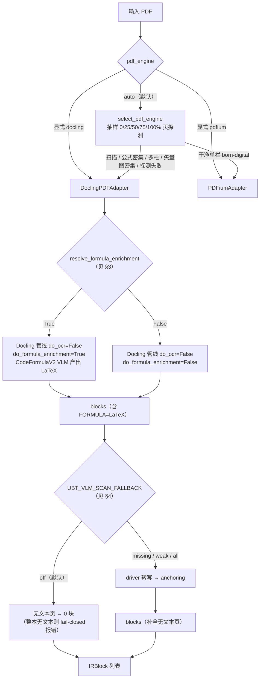
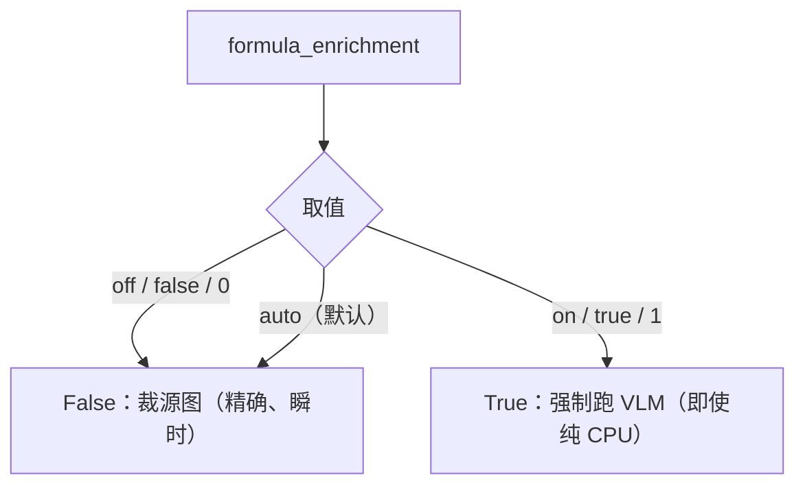
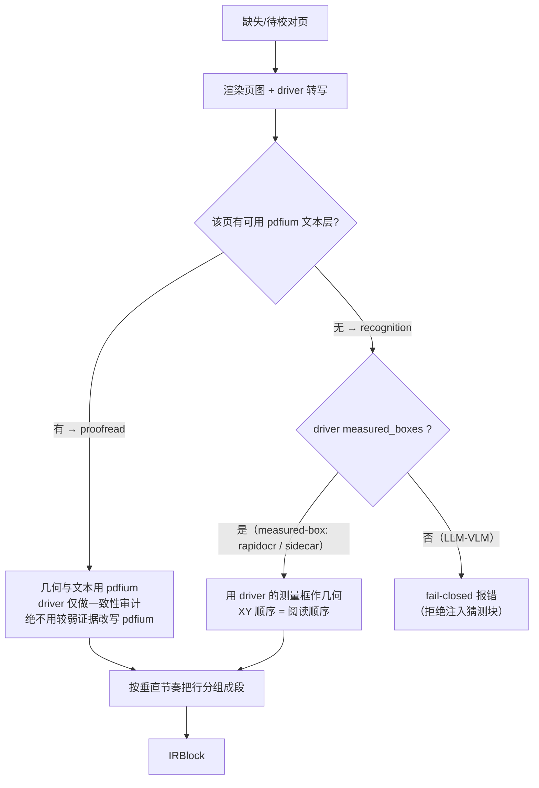

# PDF 摄取路由与 VLM 使用地图

> **状态**：🟢 活文档（随代码演进更新；代码符号与路径以 `ubt/` 源码为准）
>
> 本文只描述当前行为地图；重构动因与逐层决策记录见
> [`PDF_ENGINE_ROUTING_REDESIGN.md`](PDF_ENGINE_ROUTING_REDESIGN.md)。
> 表格/公式的高保真读图通道见 [`PADDLEOCR_VL_SERVICE.md`](PADDLEOCR_VL_SERVICE.md)。
>
> 本文档描述：一个 PDF 从输入到产出 `IRBlock` 列表，会经过哪些解析/VLM 决策点，
> 三条路径分别是什么、何时触发、解决什么痛点、如何强制开启。
>
> 本地文档：`docs/` 在 `.gitignore` 中（`/docs/`），仅供本地查阅，不会提交。
>
> 代码为准，行号可能随迭代漂移；关键符号名稳定，可用 `codegraph explore` 重新定位。

---

## 0. TL;DR

| 路径 | 触发者 | 默认行为 | 解决的核心痛点 |
|---|---|---|---|
| **A. 解析器路由** | `pdf_engine=auto`（默认） | 恒为 `docling`；探测只报告文档内容，不参与投票 | 用对工具：扫描/公式/多栏/矢量图需要 docling 的阅读顺序与结构化分类 |
| **B. docling 公式 VLM（CodeFormulaV2）** | `formula_enrichment=auto/on` | 只有 `on` 会跑；`auto` 下不可读公式改裁源图（精确且瞬时） | 显示公式保真：公式成为可重排/可校验/闭环保护的“数学原子”，而非被翻译损坏 |
| **C. 扫描页 VLM driver 层（自研）** | `UBT_VLM_SCAN_FALLBACK` + `ocr_mode` | 默认 `off` | 无文本层页的安全转写：几何不被幻觉、页面不外泄、成本不失控、驱动可替换（tier 语义见 [`OCR_DRIVERS.md`](OCR_DRIVERS.md)） |

一句话：**docling 负责“有文本层时的结构化与公式保真”，自研 driver 层负责“没有文本层时如何安全地把文字读回来”。**

---

## 1. 总体决策流（PDF → IRBlock）



ASCII 版（无 Mermaid 环境）：

```
PDF
 │
 ├─ pdf_engine=docling ─────────────────────────────► Docling
 ├─ pdf_engine=pdfium  ─────────────────────────────► PDFium
 └─ pdf_engine=auto ───► Docling（无条件）
                          （探测结果只写进报告/警告，不改变引擎选择；
                            扫描件在 pdfium 模式下也会逃逸到 Docling）

Docling ──► resolve_formula_enrichment ──True──► do_formula_enrichment=True  (CodeFormulaV2 VLM)
                                       └─False──► do_formula_enrichment=False

（docling 或 pdfium 产出 blocks 之后）
UBT_VLM_SCAN_FALLBACK=off   ─► 无文本页保留 0 块（整本无文本则报错）
                     =missing/weak/all ─► vlm driver 转写 ─► anchoring ─► 补块
```

---

## 2. 路径 A：解析器路由

**入口**：`ubt/adapters/factory.py:73-170`（`_resolve_pdf_adapter`）。
**默认值**：`pdf_engine = "auto"`（`ubt/core/config.py:598`），语义是**恒选 docling**。
CLI `--pdf-engine`（`translate.py`）。预设也控制它：`high_fidelity`/`standard` → `auto`，
`preview`/`fast` → `pdfium`；显式 `--pdf-engine` 永远优先。
**探测实现**：`ubt/adapters/pdf/pdf_profiler.py`（只产出内容信号，不投票选引擎）。

> **当前语义（2026-10 之后）**：`auto` 无条件选 docling，因为没有 `docling` 时它会
> **降级**到 pdfium 几何抽取并发 warning（`factory.py` 的 `importlib.util.find_spec`
> 分支 + `docling_adapter._extract_blocks_sync` 的 pypdfium2 回退）。
> 只有**显式** `--pdf-engine docling` 在缺包时被拒绝（`OptionalDependencyError`）。
> `pdfium` 是显式快车道：扫描件（无文本层）仍是唯一会自动逃逸到 docling 的情况，
> 因为 pdfium 对扫描件抽 0 块——那是能力边界，不是偏好。
> 完整背景见 [`PDF_ENGINE_ROUTING_REDESIGN.md`](PDF_ENGINE_ROUTING_REDESIGN.md)。
>
> 历史记录（已失效）：2026-10-10 曾把默认改为 `pdfium` 并移除 docling 的自动加载权，
> 之后被反向修正；本节之前残留的"默认 pdfium / auto 首页启发式"表述即来自那次变更。

### 2.1 探测信号与阈值

`inspect_pdf_profile`（`pdf_profiler.py:103-259`）抽样页（`PROBE_SAMPLE_FRACTIONS = (0.0, 0.25, 0.5, 0.75, 0.92)`，前/中/后防封面欺骗，末页 0.92 避开参考文献页的人名缩写误判）。注意：**auto 恒选 docling**，探测只产出 assess 证据，不投票；这些信号用于评估报告：

| 信号 | 判据 | 常量 |
|---|---|---|
| 扫描件 | 抽样页中过半 `n_chars < 32` | `PROBE_MIN_CHARS = 32` |
| 公式密集 | 任一文本页 `formula_debris_share >= 0.10` | `PROBE_FORMULA_SHARE = 0.10` |
| 多栏 | 行数 ≥ 6 且右栏边缘占比 > 0.25 | `PROBE_MIN_ROWS = 6`, `PROBE_COLUMN_SHARE = 0.25` |
| 矢量图密集 | 过半抽样页路径操作数 ≥ 200 或含图像资源 | `PROFILE_VECTOR_PATH_OPS = 200` |

- 探测结果写入 `PDFDocumentProfile`（`pdf_profiler.py:58-63`）供 assess 报告消费。
- **探测失败保守回退 docling**（不可读、缺 pypdfium2 等，`pdf_profiler.py:243-259`）。
- 常量定义：`ubt/core/policy/layout_policy.py:252-290`。

### 2.2 强制/覆盖

- `UBT_PDF_ENGINE` / `--pdf-engine`：显式指定即完全覆盖探测（`factory.py:75-145`）。
- `pdf_engine="pdfium"` 被强制在公式密集/扫描文档上时**不静默**：会 `logger.warning` 提示预期降级（`factory.py:88-145`）。
- `babeldoc` 已废弃并报错（`factory.py:83-87`）。
- docling 未安装时回退：pypdfium2 几何抽取 → pdf_oxide 纯文本（`docling_adapter.py:446-466`）。

---

## 3. 路径 B：docling 内置公式 VLM（CodeFormulaV2）

**判定**：`resolve_formula_enrichment`（`ubt/adapters/pdf/docling_parser.py:170-228`）。
**调用点**：`DoclingPDFAdapter._resolve_formula_enrichment`（`docling_adapter.py:497-502`）→ `extract_with_docling(..., enrich=...)`（`docling_parser.py:795-818`）。
**管线开关**：`options.do_ocr = False`（恒定）、`options.do_formula_enrichment = enrich`（`docling_parser.py:818-819`）。

> docling 侧唯一的**生成式 VLM** 就是 CodeFormulaV2（公式 → LaTeX）。
> 版面模型 `docling-layout-heron`、表格模型 `docling-models`(TableFormer) 是判别式视觉模型，每页/表格用，不算 VLM。
> 未使用 docling 的 `VlmPipeline` / SmolDocling / `do_picture_description`（全仓无引用）。
> OCR 后端 easyocr/tesserocr 未安装，`do_ocr=True` 无处可去。

### 3.1 决策树



### 3.2 关键结论

- **默认配置**（`formula_enrichment=auto`）恒取源图裁剪：作者原式、逐字形保真、瞬时完成，
  不考虑是否有 GPU。VLM 转写是**生成式**的，即使裁好了边距，模型仍会误读个别符号
  （实测：`expert` → `\exp`），所以它不做默认。
- 渲染引擎不再是输入：所有 PDF 都走同一个源页画布 `overlay` 引擎
  （`ubt.core.config.RENDER_ENGINE`），所以没有“显式指定引擎就关掉 VLM”这条了。
- `formula_enrichment="off"` 与 `auto` 同效（都走裁图），保留该取值用于显式表达意图。
- `formula_enrichment="on"` 是**无条件短路**，绕过所有检查，包括 GPU 探测：
  调用方要求可重排/可校验的矢量数学，并接受模型的错误率与耗时。

### 3.3 如何强制启用

```bash
# 强制公式 VLM：解析器钉在 docling（避免 auto 路由到 pdfium），环境变量开公式增强
UBT_PDF_ENGINE=docling UBT_FORMULA_ENRICHMENT=on ubt translate book.pdf
```

其它入口：配置文件 `formula_enrichment = "on"`；API `formula_enrichment="on"`（`ubt/api/models.py:181`）；
MCP 同名参数（`ubt/mcp/server.py:335`）。

**裁剪边距与重复守卫**（`UBT_FORMULA_CROP_MARGIN`，默认 `0.08`）：
Docling 在 VLM 读取前，会按公式 bbox 宽高各扩一定比例裁剪（`expansion_factor`）。
官方默认 **0.18** 在紧凑的学术版面上会伸进公式编号与相邻正文行，模型于是把那段文字也
转写进 LaTeX（docling#4548）；过紧的裁剪又可能触发重复循环。因此解析器在 `enrich=True`
时通过官方 preset API 显式设定：

```python
CodeFormulaVlmOptions.from_preset(
    "codeformulav2", expansion_factor=<margin>, stop_on_repetition=True
)
```

`formula_crop_margin` 默认 0.08（`ubt/core/config.py`），可经 `UBT_FORMULA_CROP_MARGIN`
调节（0.0–0.5）。该值属于引擎细节，只经环境变量 / 配置文件暴露，不出现在 REST / MCP 用户面
（见 `tests/unit/test_option_surface_parity.py`）。仅在 `formula_enrichment=on` 生效；
默认的截图回退路径不做带边距的裁剪，因此不受影响。

**为什么默认仍是截图（实测证据）**：修复边距后，VLM 的"尾部混入正文"已消除，
但 CodeFormulaV2 仍会**误读符号**。用论文 2101.03961v3 全流程对比：

| 公式 | 默认截图 | VLM 增强（margin 0.08 + 守卫） |
|---|---|---|
| (1) 路由概率 | 作者原式 | ✅ |
| (2) `\sum_{i\in\mathcal{T}}` | 作者原式 | ✅ |
| **(3) `expert capacity`** | 作者原式 | ❌ 误读为 `\exp{\cap c a p a c i t y}` |
| (4)(6) | 作者原式 | ✅ |
| (5) `f_i` | 作者原式 | ✅（修复后干净） |
| (7) `einsum` | 作者原式 | ✅ `\text{einsum}` |

截图是**逐字形保真**的：作者写 `expert capacity`，读者就读到 `expert capacity`。
VLM 是**生成式**的：它按自己的理解重写公式，一旦误读就交付一个**错误的数学表达式**，
比"分辨率略低但正确"的截图更糟。所以增强默认关闭，仅当调用方明确需要可重排/可校验的
矢量数学、且接受模型的错误率时才开启。

**前置与代价**（`docling_parser.py`）：
- 需要 docling（`uv sync --extra pdf`）与其 VLM 依赖（torch/transformers 随 docling 装入）；
  必须 **docling≥2.136**：`expansion_factor` / `stop_on_repetition` 由 docling#4548 引入；
- 需要 `CodeFormulaV2` 模型：`configure_hf_environment(enrich=True)` 将其加入必需仓库（`:179-180`），
  未缓存则从 huggingface.co 下载；`UBT_ALLOW_HF_MIRROR=1` 可改走 `hf-mirror.com`；
- 无 GPU 时也会在 CPU 上跑，注释实测约 15–60s/公式（`:151-160`）；
- 失败分层降级：离线在线重试 → 关 VLM 重抽 → CUDA 退 CPU（`:575-614`），不会整单崩；
- 结果按 (文件 SHA、页范围、管线选项、docling 版本、enrich 标志) 磁盘缓存（`:230-278`）；
  因管线选项含 `code_formula_options`、且缓存键含 docling 版本，改边距或升版都会自动失效旧缓存。

---

## 4. 路径 C：扫描页 VLM driver 层（项目自研，非 docling 内置）

**目录**：`ubt/adapters/pdf/vlm/`。
**入口**：`vlm_fallback_missing_pages`（`docling_parser.py:2036`）← `DoclingPDFAdapter._vlm_fallback_missing_pages`（`docling_adapter.py:471-492`）。

### 4.1 分级触发（`UBT_VLM_SCAN_FALLBACK`）

`get_fallback_mode`（`vlm/transcribe.py:44-60`）；`vlm_fallback_missing_pages`（`docling_parser.py:2036-2371`）：

| 档位 | 行为 |
|---|---|
| `off`（默认） | 不改动块。**但**若 `ocr_mode` 显式设置，或整本无文本内容且 `ocr_mode != off`，自动升为 `missing`（`:1497-1503`） |
| `missing` | 只转写 **0 块页**（扫描/无文本层） |
| `weak` | 追加：公式碎片率 ≥ 0.10 或文本稀疏的页做 VLM proofread（`:1557-1568`） |
| `all` | 追加：所有非 `editable_text` 页 proofread/recognition（`:1540-1554`） |

- 整本无文本且兜底关闭 → `_reject_empty_book` **fail-closed 报错**，而不是导出一本空书（`docling_parser.py:1860-1934`）。

### 4.2 转写与锚定（几何安全的关键）



- 锚定规则：`vlm/anchor.py:57-125`。**driver 只负责识别文字，几何由 anchoring 掌控**；
  pdfium 文本层先投票（proofread 模式），只有真无文本页才用**有测量框**的 driver；LLM-VLM 在此 fail-closed。
- 段落分组：`vlm/transcribe.py:87-100`（否则一页密集扫描产生数百行块，LLM 阶段磨数小时）。
- 可转写类型白名单：`_VLM_TEXTUAL_TYPES`（NARRATIVE/HEADING/DIALOGUE/LIST_ITEM），
  不会删除它无法重建的 IMAGE/TABLE/FORMULA/CODE（`docling_parser.py:1919-1934`）。
- 付费通道有熔断：`VLM_CIRCUIT_MIN_TRIES` / `VLM_CIRCUIT_FAIL_PCT`（`ubt/core/policy/layout_policy.py:412-413`，`docling_parser.py:2230`消费）。

### 4.3 driver 选择（隐私/成本优先）

`probe_effective_driver`（`vlm/registry.py:135-306`），`ocr_mode ∈ {auto, local, vlm, off}`（`config.py:123`）：

- `auto` 顺序：**local（sidecar → in-process rapidocr）→ vlm（unlimited-ocr2 / 远程端点）最后**；
- `allow_page_upload=false`（默认，`config.py:838`）**阻止**非本地 sidecar 和 `vlm` 远程端点；
- 本地判定基于**解析后的主机**（`_endpoint_is_local`，`:16-37`），防 `127.0.0.1.attacker.example` 绕过；
- 自动链选到付费云引擎会 `logger.warning` 点名，且 OCR token 记入运行 usage sink（`vlm/drivers/cloud_driver.py:31-46`）；
- 驱动注册表：`rapidocr` / `unlimited-ocr2` / `sidecar`(=`http`) / `cloud` / `vlm`（`registry.py:127-132`），
  默认驱动由 `UBT_VLM_DRIVER` 决定（默认 `rapidocr`，`:83-84`）。详情与配置见 [`OCR_DRIVERS.md`](OCR_DRIVERS.md)。

---

## 5. 各路径解决的痛点（浓缩）

**路径 A（路由）**：用对工具。扫描件需要视觉/OCR；多栏需要阅读顺序重建；
公式碎片经 pdfium 会被切成幻影标题并污染翻译/QE/修复（`pdf_profiler.py:5-16`）。

**路径 B（公式 VLM）**：
- 把显示公式从“碎裂文本”变成结构化 `FORMULA` + LaTeX，成为**不可翻译原子**；
- 闭环保护：导出阶段 `FORMULA` 目标漂移重置回源（“LLM 绝不能成为公式内容来源”，`math_guard.py:1-23`）；
- 无定界符的 unicode soup 由 `soup_math.py` 掩码，避免被“翻译”成垃圾并盖掉完好的矢量原图；
- LaTeX 经 Typst 重排为矢量公式；无定界符碎片由几何预检保护，无法安全重排时无损保留源图。

**路径 C（扫描 VLM driver 层）**：
- docling OCR 后端未装、`do_ocr=False` → 无文本页 0 块，此层负责补回；
- **几何不被幻觉**（VLM 只识别文字，锚定掌控几何，未测量驱动 fail-closed）；
- **隐私**（本地优先、`allow_page_upload` 出网闸、按解析主机判定）；
- **成本**（付费先告警、token 记入账单、熔断）；
- **可插拔**（换驱动不改上层）；**fail-closed**（未知驱动/无测量几何/空转写都报错）。

---

## 6. 配置 / 环境变量 / CLI 速查

| 配置字段 | 环境变量 | CLI | 默认 | 作用 |
|---|---|---|---|---|
| `pdf_engine` | `UBT_PDF_ENGINE` | `--pdf-engine` | `auto` | 解析器：`auto`（=docling，缺包时降级 pdfium）/`docling`（保真，缺包即拒绝）/`pdfium`（快车道） |
| `docling_device` | `UBT_DOCLING_DEVICE` | — | `auto` | Docling 加速器：`auto`/`cpu`（不占显存）/`cuda` |
| `formula_enrichment` | `UBT_FORMULA_ENRICHMENT` | — | `auto` | 公式 VLM：`auto`（裁源图，默认）/`on`（强制 VLM 转写）/`off`。引擎细节，由 preset 或环境变量设置 |
| `ocr_mode` | `UBT_OCR_MODE` | `--ocr` | `auto` | 扫描 driver：`auto`/`local`/`vlm`/`off`（详细语义见 [`OCR_DRIVERS.md`](OCR_DRIVERS.md)） |
| `allow_page_upload` | `UBT_ALLOW_PAGE_UPLOAD` | — | `false` | 是否允许页图出网 |
| — | `UBT_VLM_SCAN_FALLBACK` | — | `off` | 扫描兜底档位：`off`/`missing`/`weak`/`all` |
| — | `UBT_VLM_DRIVER` | — | `rapidocr` | auto 模式的显式 driver 覆盖（一般不需要设） |
| — | `UBT_ALLOW_HF_MIRROR` | — | 关 | 允许从 hf-mirror.com 下载模型 |

---

## 7. 源码地图（file:line）

| 主题 | 位置 |
|---|---|
| 解析器路由/注册 | `ubt/adapters/factory.py:75-170` |
| 首页启发式探测 | `ubt/adapters/pdf/pdf_profiler.py:103-259` |
| 探测阈值常量 | `ubt/core/policy/layout_policy.py:243-263` |
| docling 抽取/管线开关 | `ubt/adapters/pdf/docling_parser.py:795-819` |
| 公式 VLM 判定 | `ubt/adapters/pdf/docling_parser.py:170-228` |
| HF 环境/模型仓库 | `ubt/adapters/pdf/docling_parser.py:230-290` |
| 公式 VLM 降级阶梯 | `ubt/adapters/pdf/docling_parser.py:992-1040` |
| 扫描兜底入口 | `ubt/adapters/pdf/docling_parser.py:2036-2371` |
| 空书 fail-closed | `ubt/adapters/pdf/docling_parser.py:1860-1934` |
| 扫描页适配器接线 | `ubt/adapters/pdf/docling_adapter.py:392-411,331-361` |
| driver 注册/探测 | `ubt/adapters/pdf/vlm/registry.py:71-306` |
| 转写/兜底档位 | `ubt/adapters/pdf/vlm/transcribe.py:20-68` |
| 锚定（几何安全） | `ubt/adapters/pdf/vlm/anchor.py:1-125` |
| 公式碎片/保护 | `ubt/core/validators/math_guard.py:1-23`、`ubt/core/cleaners/soup_math.py:154` |
| GPU 探测 | `ubt/core/env.py:56-63` |
| 配置字段/默认 | `ubt/core/config.py:123,610-635,812-838` |
